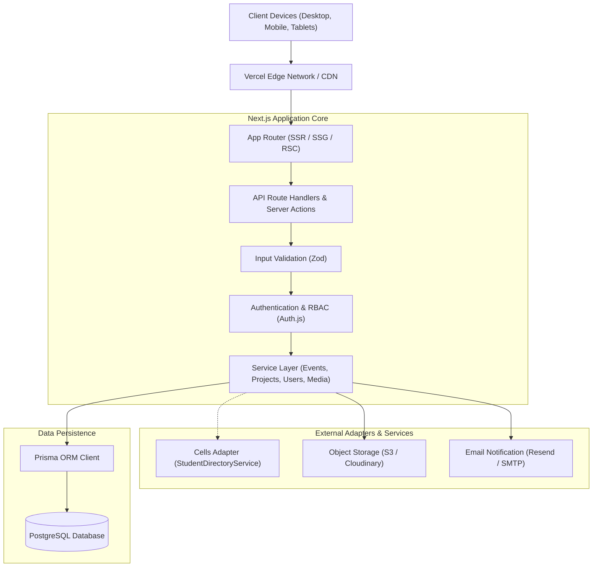

# CoRE System Architecture

> **System Architecture & Technical Specifications**  
> **Platform:** CoRE Web (Center of Research and Excellence, VCET Puttur)  
> **Repository:** [core-vcet/Core-Web](https://github.com/core-vcet/Core-Web)

---

## 🏛️ 1. High-Level Architecture Overview

CoRE Platform is built as a unified full-stack application utilizing **Next.js (App Router)** with **TypeScript**, **PostgreSQL**, and **Prisma ORM**. It unifies public showcasing, member identity & project tracking, and administrative event operations within a single, maintainable repository.



---

## 🥞 2. The Three-Layer Architecture

The application is structured into three clear operational layers, allowing independent evolution while sharing unified data models:

```
+-------------------------------------------------------------------------+
| Layer 1: PUBLIC SHOWCASE                                                |
|   - High-performance SSR/SSG pages (Home, About, Projects, Events,     |
|     People Directory, Achievements, Gallery, Contact)                   |
|   - Open access, SEO optimized, instant loading                          |
+-------------------------------------------------------------------------+
| Layer 2: AUTHENTICATED MEMBER PLATFORM                                  |
|   - User authentication & verified student profiles                     |
|   - Event registration, team creation & participation history           |
|   - Project contribution tracking & member portfolio timeline           |
|   - Membership application onboarding flow                              |
+-------------------------------------------------------------------------+
| Layer 3: ADMIN & EXPERIMENTAL INFRASTRUCTURE                            |
|   - Role-Based Access Control (Admin, Event Organizer, Super Admin)    |
|   - Moderation workflows (Projects, Achievements, Applications)         |
|   - Event lifecycle & attendee CSV export                               |
|   - In-browser code runner / Playground (Future sandbox)                |
+-------------------------------------------------------------------------+
```

---

## ⚙️ 3. Technology Stack & Rationale

| Component | Selected Technology | Rationale |
|---|---|---|
| **Framework** | Next.js 14+ (App Router) | Combines fast server-rendered marketing pages (SEO) with interactive authenticated dashboards in one repo. Eliminates multi-service hosting overhead. |
| **Language** | TypeScript (Strict mode) | Provides end-to-end type safety from database models down to UI props. Crucial for large student team collaboration. |
| **Styling** | Tailwind CSS + Lucide Icons | Utility-first CSS provides complete control over customized dark-theme aesthetics without framework lock-in. |
| **Database** | PostgreSQL | Our domain is intrinsically relational (Members -> Projects -> Events -> Registrations). Postgres guarantees relational integrity and ACID compliance. |
| **ORM** | Prisma ORM | Automated migrations, typed client generation, and schema-as-code simplify database operations for contributors. |
| **Authentication** | Auth.js (NextAuth) | Secure session management, HttpOnly cookies, password hashing (Argon2/bcrypt), and extensible OAuth providers. |
| **Validation** | Zod | Server-side runtime schema validation for every API endpoint, server action, and form submission. |
| **Media Storage** | S3-Compatible / Cloudinary | Direct-to-storage uploads; only validated URLs and image metadata are stored in the database. |

---

## 📂 4. Project Directory Structure

```
Core-Web/
├── .github/
│   └── workflows/              # GitHub Actions CI/CD pipelines
├── prisma/
│   ├── schema.prisma           # Relational schema definition
│   └── migrations/             # Versioned SQL migrations
├── public/                     # Static media, icons, and assets
├── src/
│   ├── app/                    # Next.js App Router
│   │   ├── (public)/           # Public route group (home, about, projects, events)
│   │   ├── (member)/           # Authenticated member dashboard and profiles
│   │   ├── (admin)/            # Admin management dashboard
│   │   ├── api/                # REST endpoints and webhooks
│   │   ├── layout.tsx          # Root layout
│   │   └── page.tsx            # Home landing page
│   ├── components/             # Reusable UI component library
│   │   ├── ui/                 # Atomic design primitives (Button, Input, Badge)
│   │   ├── navigation/         # Header, Navbar, Mobile Menu, Footer
│   │   ├── projects/           # Project cards, filters, detail view
│   │   └── events/             # Event cards, schedule timeline, registration modal
│   ├── lib/                    # Shared utility libraries
│   │   ├── auth.ts             # Auth.js configuration & session helpers
│   │   ├── prisma.ts           # Singleton Prisma client instance
│   │   └── utils.ts            # ClassName merging and string helpers
│   ├── services/               # Business logic & data access layer
│   │   ├── project.service.ts  # Project CRUD & contributor attribution
│   │   ├── event.service.ts    # Event management & registration workflows
│   │   ├── member.service.ts   # Member profiles & skills
│   │   └── adapters/           # External service integration adapters
│   │       └── cells.adapter.ts# VCET Cells integration adapter
│   └── types/                  # Global TypeScript interfaces & Zod schemas
├── docs/                       # Project documentation
│   ├── ARCHITECTURE.md
│   ├── CONTRIBUTING.md
│   ├── DESIGN.md
│   └── PRD.md
├── .env.example                # Template for environment variables
├── .gitignore
└── README.md
```

---

## 🔄 5. Data Flow & Service Layer Pattern

To keep business logic decoupled from presentation and routing, all database queries and validation rules are contained within the **Service Layer**:

```
[Browser Request]
       │
       ▼
[Next.js App Router Page / Route Handler]
       │
       ▼ (Validates Payload)
[Zod Schema Validation]
       │
       ▼ (Checks Permissions)
[Auth & RBAC Guard]
       │
       ▼
[Domain Service (e.g., EventRegistrationService)]
       │
       ▼
[Prisma Client Transaction]
       │
       ▼
[PostgreSQL Database]
```

---

## 🔌 6. Adapter Pattern (VCET Cells Integration)

To support integration with the VCET Cells student directory without introducing a hard runtime dependency, we implement an **Adapter Pattern**:

```typescript
// Interface contract
export interface IStudentDirectoryService {
  findStudentByUSN(usn: string): Promise<StudentProfile | null>;
  verifyEnrollment(usn: string, email: string): Promise<boolean>;
}

// Concrete fallback / internal implementation
export class LocalDirectoryAdapter implements IStudentDirectoryService { ... }

// External Cells integration adapter (plugged in when API is available)
export class CellsDirectoryAdapter implements IStudentDirectoryService { ... }
```

If Cells endpoints become unavailable or change schemas, only the adapter is modified. The core registration workflows remain unaffected.

---

## 🛡️ 7. Security Architecture

1. **Defense-in-Depth Authorization:** Role and ownership checks are always executed on the server inside service functions, never solely reliant on client UI state.
2. **Data Sanitization:** Strict Zod parsing on all inbound JSON payloads prevents injection vectors. Prisma uses parameterized queries by default, protecting against SQL injection.
3. **Privacy by Design:** Sensitive student information (such as USN and phone numbers) is segregated in private database models (`StudentProfile`) and excluded from public GraphQL / REST serialization.
4. **Credential Safety:** Passwords are encrypted using Argon2/bcrypt. Secrets are managed exclusively via environment variables and never checked into source control.

---

## 🚀 8. Deployment & CI/CD Pipeline

- **GitHub Actions:**
  - Automated pull request checks: `TypeScript typecheck` + `ESLint` + `Prisma validate`.
  - Preview deployments generated automatically per branch.
- **Production Deployment:**
  - Fast deployments from `main` branch with automated database migration checks.
  - Automated daily backups for PostgreSQL databases.
